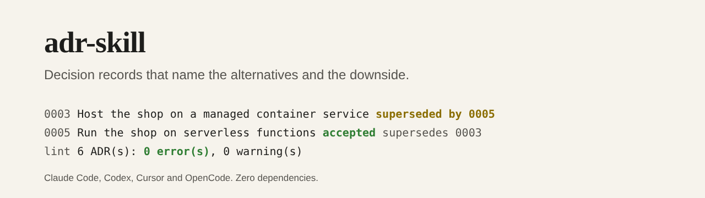

# adr-skill



[](https://github.com/pJijesh/adr-skill/actions/workflows/test.yml) [](LICENSE)  

**Problem:** most architecture decision records are written after the fact, name one option, and list only the benefits. A year later nobody can tell why the decision was made or what it cost, and the argument starts again.

**For:** IT managers, architects and engineers who want an AI agent to help write decision records that hold up, and a decision log that stays consistent as it grows.

**Demonstrates:** an agent skill that interviews for real context and real alternatives, drafts a short record with honest consequences, and a zero-dependency CLI that creates, supersedes, lints and indexes the log. A worked decision log for a fictional bookshop is included and is checked by the tests.

## What it does

- **A process the agent follows**: find the log, read what exists, interview one question at a time, draft, set an honest status, lint, index. See [`SKILL.md`](skills/adr/SKILL.md).
- **A template that forces the hard parts**: at least two options, a Decision that names the one chosen, Consequences with both Good and Bad, and a Review trigger.
- **A status lifecycle**: `proposed`, `accepted`, `rejected`, `deprecated`, `superseded`. Accepted records are not rewritten; `supersede` creates the new record and links both sides.
- **A linter with 20 rules** (14 errors, 6 warnings): file naming, numbering, headings, status and date, required sections, option count, a Decision that names its option, honest consequences, supersession links that agree both ways, leftover placeholders, stale proposals. See [`lint-rules.md`](skills/adr/references/lint-rules.md).
- **An index builder** that produces a deterministic decision log table, with a `--check` mode for CI.
- **Installers** for Claude Code, Codex, OpenCode and Cursor.

## Install

Requires Node 18 or later. From a clone of this repository:

```bash
node scripts/install.mjs claude            # into the current project
node scripts/install.mjs codex
node scripts/install.mjs opencode
node scripts/install.mjs cursor
node scripts/install.mjs all --dry-run     # show what would be written
node scripts/install.mjs claude --global   # Claude Code, every project
```

| Agent | What is written |
| --- | --- |
| Claude Code | The skill in `.claude/skills/adr/` (or `~/.claude/skills/` with `--global`) |
| Codex | The skill in `.agents/skills/adr/` and a marked block in `AGENTS.md` |
| OpenCode | The skill in `.opencode/skills/adr/` and a marked block in `AGENTS.md` |
| Cursor | A rule in `.cursor/rules/adr.mdc` and the scripts in `.cursor/adr/` |

Then ask your agent, for example: "Using the adr skill, record our decision to move hosting to serverless functions."

You can also use the CLI on its own:

```bash
node skills/adr/scripts/adr.mjs new docs/adr "Use PostgreSQL for the catalogue"
node skills/adr/scripts/adr.mjs supersede docs/adr 3 "Run the shop on serverless functions"
node skills/adr/scripts/adr.mjs status docs/adr 5 accepted
node skills/adr/scripts/adr.mjs lint docs/adr
node skills/adr/scripts/adr.mjs index docs/adr --out docs/adr/README.md
```

## How it works

```text
interview -> new / supersede -> write -> status -> lint -> index
                  |                                  |        |
         numbers the file,                 20 rules, exit 1    decision log
         links both sides                  on errors           table + --check
```

The worked example in [`examples/adr/`](examples/adr/) is a six-record log for a fictional bookshop, including one superseded decision and one proposal still open:

```text
$ node skills/adr/scripts/adr.mjs lint examples/adr --today 2026-11-11
6 ADR(s): 0 error(s), 0 warning(s)
```

Its index is [`examples/adr/README.md`](examples/adr/README.md), generated by the tool.

A fresh record from `adr.mjs new` fails the linter on purpose, because the template placeholders are still there. It only passes once someone has written it.

## How it is built

```text
.
├── skills/adr/
│   ├── SKILL.md              The process and ground rules
│   ├── core.md               Condensed text for AGENTS.md and Cursor
│   ├── references/           when to write, writing guide, lifecycle, good and bad, lint rules
│   └── scripts/              adr.mjs (CLI), lib.mjs (parse, lint, index), rules.json
├── scripts/                  install.mjs and build.mjs (generates the adapters)
├── adapters/                 Generated AGENTS.md block and Cursor rule
├── examples/adr/             A fictional decision log and its generated index
├── test/                     node:test suites
└── .github/workflows/test.yml
```

## Design choices

- **A decision needs alternatives.** The linter requires two options and a Decision that names the winner, because a record with one option is an announcement, not a decision.
- **Bad consequences are mandatory.** Every decision costs something. A record with no downside has not been thought through.
- **History is not rewritten.** Superseding keeps the old reasoning visible and links forward, so a reader can follow how thinking changed.
- **Links are checked both ways.** A supersession that only one record knows about is a broken log.
- **Structure is checked; truth is not.** The linter is honest about what it can see.
- **Zero dependencies and deterministic output**, so the index can be checked in CI.

## Limitations

- **It cannot judge the reasoning.** A well-formed record can still record a bad decision.
- **The agent can still invent context.** The skill tells it to ask and never to make up facts, but you should read what it writes.
- **One format.** The template is a short, opinionated one. If your organisation uses another ADR format, the linter will not fit without changes to `lib.mjs`.
- **No tooling for diagrams, approvals or notifications.** It manages files, nothing more.
- **Dates come from the machine clock** unless you pass `--date` or `--today`.
- **The installer paths follow each tool's documentation as I understand it.** They have not been tested inside Claude Code, Codex, OpenCode or Cursor themselves.

## Verification status

- The tests cover each of the 20 lint rules, parsing, the `new`, `supersede` and `status` commands and their failure cases, index determinism and `--check`, exit codes, `--json`, argument handling, each installer in a temporary directory, that the generated files are current, and repository hygiene. A test also fails if a rule is missing from `rules.json`, the documentation or the tests.
- The worked example lints clean and its index matches the generator's output.
- It was run on Node 22 here. The CI workflow covers Node 18, 20 and 22.
- The skill has not been tested with a real agent on a real team's decision log, so there is no claim about how it performs in practice.

## Roadmap

Planned, not promised.

- **Next:** Try it with each of the four agents on a real decision log and record what the linter catches
- **Then:** An optional `adr.mjs check-links` for references to other files and issues
- **Later:** A second, longer template for decisions with a cost model

## Related work

The structure is inspired by common ADR practice, including Michael Nygard's original idea of short decision records and the MADR template. This repository shares none of their text or code; it is a small, opinionated take with a linter.

## Licence

[MIT](LICENSE), 2026 Puliyappottammal Jijesh. See [CONTRIBUTING](CONTRIBUTING.md) for how to suggest a change.

Built by [Puliyappottammal Jijesh](https://www.linkedin.com/in/pjijesh), an IT manager. [GitHub](https://github.com/pJijesh)
